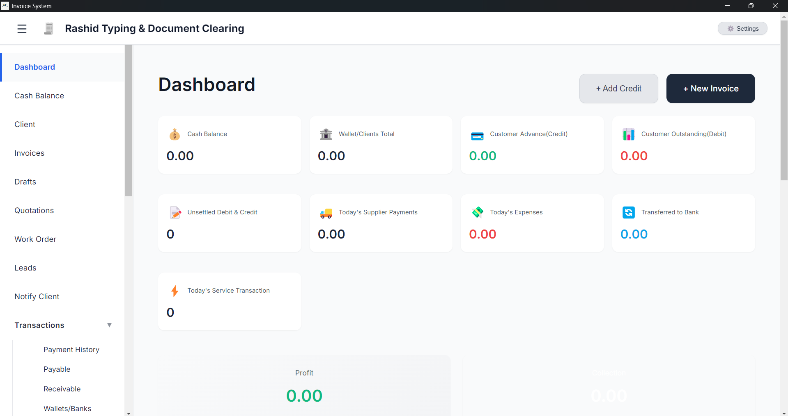

# 💼 Invoice Management System



A comprehensive, professional-grade Invoice Management System designed for efficiency and ease of use. Built with a modern tech stack, it provides a seamless desktop experience with a powerful backend for handling clients, invoices, quotations, and financial tracking.

---

## ✨ Key Features

- **📊 Dynamic Dashboard**: Real-time overview of cash balance, wallet/clients total, customer advances (credits), and outstanding balances (debits).
- **📝 Comprehensive Management**:
  - **Invoices**: Create and manage professional invoices.
  - **Quotations**: Generate and track business quotes.
  - **Work Orders**: Manage service delivery and tracking.
  - **Leads**: Track potential clients and opportunities.
- **👥 Client Management**: Detailed client database with transaction history and credit tracking.
- **💰 Financial Tracking**:
  - **Cash Balance**: Monitor physical and bank-transferred cash.
  - **Payables & Receivables**: Keep track of what you owe and what is owed to you.
  - **Profit Reports**: Automated profit and loss analysis.
- **🔔 Client Notifications**: Integrated system to notify clients regarding payments and status.
- **🛡️ Secure & Offline-First**: Desktop application with embedded PostgreSQL database for high performance and data security.

---

## 🛠️ Tech Stack

- **Frontend**: [React](https://reactjs.org/) + [Vite](https://vitejs.dev/) + [TypeScript](https://www.typescriptlang.org/)
- **Backend**: [Django](https://www.djangoproject.com/) + [Django REST Framework](https://www.django-rest-framework.org/)
- **Desktop Wrapper**: [Electron](https://www.electronjs.org/)
- **Database**: [PostgreSQL](https://www.postgresql.org/) (Embedded for production)
- **Styling**: Vanilla CSS / Tailwind CSS

---

## 🚀 Getting Started

### Prerequisites

- [Node.js](https://nodejs.org/) (v18 or higher)
- [Python](https://www.python.org/) (v3.11 or higher)
- [npm](https://www.npmjs.com/)

### Development Setup

1. **Clone the Repository**
   ```bash
   git clone <repository-url>
   cd invoice-system
   ```

2. **Backend Setup**
   ```bash
   cd backend
   python -m venv venv
   source venv/bin/activate  # venv\Scripts\activate on Windows
   pip install -r requirements.txt
   cp .env.example .env      # Configure your local database
   python manage.py migrate
   ```

3. **Frontend Setup**
   ```bash
   cd ../frontend
   npm install
   npm run dev
   ```

---

## 📦 Building the Desktop App (.exe)

To package the application as a single self-contained executable for clients:

1. **Prepare Resources**:
   First-time run only (downloads embedded Python & PostgreSQL):
   ```bash
   cd electron-installer
   prepare-resources.bat
   ```

2. **Build Installer**:
   ```bash
   build-installer.bat
   ```
   The final `.exe` will be located in `electron-installer/dist/`.

---

## 🤝 Contributing

1. Fork the Project
2. Create your Feature Branch (`git checkout -b feature/AmazingFeature`)
3. Commit your Changes (`git commit -m 'Add some AmazingFeature'`)
4. Push to the Branch (`git push origin feature/AmazingFeature`)
5. Open a Pull Request

---

## 📄 License

Distributed under the MIT License. See `LICENSE.txt` for more information.

---

